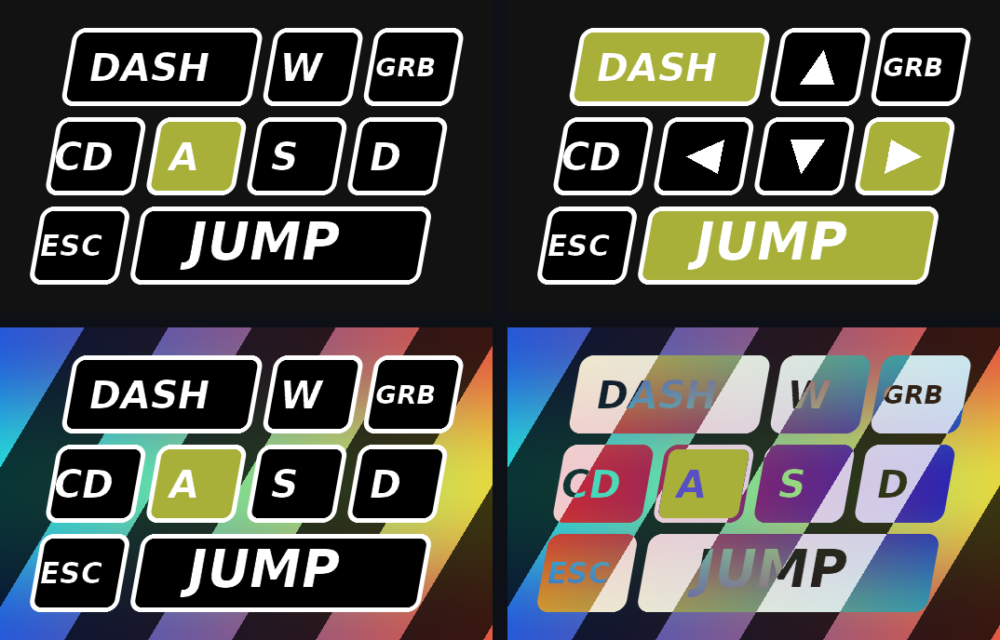

# ZKO: Zeek Overlay

**A keyboard overlay for Celeste that lights up the keys you're pressing, using your own bindings.**

ZKO is an [Everest](https://everestapi.github.io/) code mod. It draws a small slanted keyboard in a corner of the screen with Dash, Crouch Dash, Grab, Jump, the four directions and Esc. Each key lights up while you hold it. It's handy for recording runs, streaming, teaching tech, or just seeing your own inputs.



<sub>Preview made from the mod's own drawing code. Top left: default look with A held. Top right: arrow-key bindings while dashing, jumping and holding right. Bottom: the same overlay over a busy background, normal (left) and with all invert options on (right). In-game labels use Celeste's font.</sub>

---

## Features

- **Uses your own bindings.** Every key follows what you set in Celeste's Keyboard Config and Controller Config, so there's nothing to set up. Controller buttons and sticks light the keys too.
- **Shows the key you actually use.** Direction keys show the bound key's name (`W A S D`, `I J K L`, ...). Arrow-key bindings, or directions with only a controller bound, get drawn arrows.
- **Honest direction display.** Holding left and right together lights both keys, unlike the game's own movement input, which only keeps the newest one. Mirror Mode doesn't flip it either.
- **Invert mode.** The outline, key colour and labels can each be drawn by *inverting* whatever is behind them, like Minecraft's crosshair, so the overlay stays readable over any background. Pressed keys keep your pressed colour so presses still stand out.
- **Full colour control.** Key, outline, pressed and label colours each have a preset list plus exact 0 to 255 R/G/B sliders.
- **Put it anywhere.** Four corner presets with adjustable padding, or a custom X/Y position. Scale from 30% to 300%, plus opacity.
- **Choose where it appears.** Gameplay only, gameplay and the pause menu, or everywhere (map and menus too).
- **Toggle hotkey.** Bind a key or button to show and hide the overlay at any time.
- **No art assets.** Everything is drawn in code, so it stays crisp at any resolution and scale.

## Layout

```
 ┌──────────────┐ ┌─────┐ ┌─────┐
 │     DASH     │ │  ↑  │ │ GRB │
 └──────────────┘ └─────┘ └─────┘
┌─────┐ ┌─────┐ ┌─────┐ ┌─────┐
│ CD  │ │  ←  │ │  ↓  │ │  →  │
└─────┘ └─────┘ └─────┘ └─────┘
┌─────┐ ┌──────────────────────┐
│ ESC │ │         JUMP         │
└─────┘ └──────────────────────┘
```

| Key | Lights up when | Label |
|---|---|---|
| DASH | Dash is held | `DASH` |
| CD | Crouch Dash (Demo Dash) is held | `CD` |
| GRB | Grab is held | `GRB` |
| JUMP | Jump is held | `JUMP` |
| ↑ ← ↓ → | That direction is held (keyboard, D-pad or stick) | Your bound key, or an arrow |
| ESC | Pause or Esc is held | `ESC` |

## Install

1. Install [Everest](https://everestapi.github.io/) (build 5935 or newer), for example with Olympus.
2. Download `ZKO.zip` from [Releases](../../releases) (or build it yourself, see below).
3. Put `ZKO.zip` in your `Celeste/Mods` folder. Don't unzip it.
4. Start Celeste. The overlay appears in the bottom-left corner when you enter a level.

Options are under **Mod Options → ZKO (Keyboard Overlay)**.

## Settings

| Setting | Default | What it does |
|---|---|---|
| Show Overlay | On | Master on/off switch |
| Show Overlay In | Gameplay + Pause | `Gameplay Only`, `Gameplay + Pause`, or `Everywhere` (map, menus, file select...) |
| Position | Bottom Left | `Top Left`, `Bottom Left`, `Top Right`, `Bottom Right`, or `Custom` |
| Edge Padding (H / V) | 2% / 5% | Distance from the screen edge for the corner presets |
| Custom Position X / Y | 2% / 95% | Used when Position is Custom. 0% is left/top, 100% is right/bottom |
| Scale | 100% | 30% to 300% |
| Opacity | 100% | 10% to 100% |
| Key Colour | Black | Fill of an unpressed key (presets + R/G/B) |
| Invert Key Colour | Off | Unpressed keys invert what's behind them |
| Outline Colour | White | Key border (presets + R/G/B) |
| Invert Outline | Off | Borders invert what's behind them |
| Pressed Colour | Olive `#A8B03A` | Fill of a held key. Never inverted |
| Label Colour | White | Text and arrows (presets + R/G/B) |
| Invert Labels | Off | Labels invert what's behind them |
| Debug: Show Lag Spikes | Off | Shows where the time went when a frame takes over 40 ms (see [Troubleshooting](#troubleshooting)) |
| Toggle Overlay | Unbound | Hotkey to show/hide, set under Keyboard Config / Controller Config |

Settings are saved in `Celeste/Saves/modsettings-ZKO.celeste`. Colours are stored there as `RRGGBB` hex if you want to paste exact values.

## How it works

### Reading input

ZKO never asks you to configure keys because it reads the game's own input objects:

- **Dash, Crouch Dash, Grab, Jump, Pause/Esc** use Celeste's virtual buttons (`Input.Dash`, `Input.CrouchDash`, `Input.Grab`, `Input.Jump`, `Input.Pause`, `Input.ESC`). These already cover every keyboard key, controller button and mouse button you've bound, plus any extra bindings Everest adds.
- **Directions** read the raw `Settings.Instance.Left/Right/Up/Down` bindings (and their *Move Only* variants) through `Binding.Check`, using the same 0.3 stick threshold the game uses. The game's own movement axes (`Input.MoveX/MoveY`) only report the newest of two opposite keys and get mirrored in Mirror Mode. An input display should show what your fingers are doing, so ZKO doesn't use them.
- **Direction labels** come from the first keyboard key in each binding, turned into a short name (`W`, `LSH`, `;`, `N4`, ...). Arrow keys and controller-only bindings get a drawn triangle instead.

### Drawing

The overlay draws **after the whole frame is finished**, from a hook on `Monocle.Engine.RenderCore`, straight onto the screen's back buffer. Most HUD mods draw inside Celeste's HUD layer instead. ZKO does it this way for two reasons:

1. **Invert mode needs the real pixels underneath.** Celeste can render its HUD into a separate transparent buffer, and inverting "transparent" just gives white. Drawing on the finished frame means there's always a real image to invert.
2. **One code path everywhere.** The same hook works in levels, the pause menu, the overworld and other menus, which makes "Show Overlay In" straightforward. Because it draws over the pause menu, you can also watch colour changes live while you edit them.

Each key is drawn procedurally as a stack of 1-pixel-high rows in real screen pixels:

- Every row is shifted sideways by a fixed slant (0.18 px per px) to make the italic parallelogram shape. The whole grid shares one slant line, so the rows step left as they go down, like the original design.
- Rows near the top and bottom are trimmed by a circle equation to round the corners.
- A row is split into *outline | fill | outline* segments. Pixels that straddle an edge are drawn once with a coverage-weighted colour, which anti-aliases the slanted edges.
- **No pixel is ever drawn twice.** That matters for invert mode: inverting a pixel twice gives back the original colour.

Labels are drawn with Celeste's own font (`ActiveFont`) through a skewed transform matrix, so the text leans with the keys.

### Invert mode

Inverted parts use a custom blend state:

```
result = src × (1 − dst) + dst × (1 − src)
```

Drawing pure white (`src = 1`) gives `1 − dst`, the exact inverse of the background. With opacity `a` it gives `lerp(dst, 1 − dst, a)`, so the opacity slider still works. Normal and inverted parts are drawn in separate passes, and pressed keys are excluded from the fill inversion so your presses stay in the pressed colour.

### Safety

- Everything is wrapped so the overlay can't crash the game. If drawing ever throws, ZKO closes its sprite batch, writes the error once to `log.txt`, and turns itself off until restart.
- Per-frame work is a handful of input checks and a few hundred rectangles, well under a millisecond. Nothing is allocated per frame.

## Building from source

Requirements: the [.NET 8 SDK](https://dotnet.microsoft.com/download/dotnet/8.0) and Celeste with Everest installed.

```sh
git clone https://github.com/32KZ/ZKO.git
cd ZKO
dotnet build Source/ZKO.csproj -p:CelestePrefix="C:\path\to\Celeste"
```

- `CelestePrefix` is your Celeste folder (the one containing `Celeste.dll` and `Mods/`). If you clone the repo into `Celeste/Mods/ZKO`, it's found automatically. To set it once instead of on every build, copy `Source/ZKO.local.props.example` to `Source/ZKO.local.props` and put your path in it. That file is ignored by git.
- Every build copies the mod into `<CelestePrefix>/Mods/ZKO`. Add `-p:InstallToMods=false` to skip that.
- `-c Release` also writes `ZKO.zip`, ready to share.

You can also build against Everest's reference assemblies without the game installed: download `lib-stripped.zip` from the [latest Everest release](https://github.com/EverestAPI/Everest/releases/latest), unzip it, and point `CelestePrefix` at that folder.

### Project layout

```
everest.yaml              Mod metadata (name, version, DLL, Everest dependency)
Dialog/English.txt        Menu text
Source/
  ZKO.csproj              Build, install-to-Mods and zip packaging
  ZKOModule.cs            Mod entry point: hooks Engine.Update / Engine.RenderCore
  ZKOModuleSettings.cs    All settings + custom menu entries (colour editors, sliders)
  OverlayRenderer.cs      Layout, input reading, key drawing, invert blend, labels
  KeyLabels.cs            Keyboard key → short label ("LeftShift" → "LSH")
  ColorUtil.cs            Colour presets and hex parsing
  LagProbe.cs             Optional frame-time diagnostics
Docs/                     Original spec, design mock-up and build plan
```

## Troubleshooting

**The game hitches for a moment when I die.**
That isn't ZKO. When you respawn, Celeste reloads the room and the .NET runtime runs a full garbage collection. With a lot of mods loaded that can take a few hundred milliseconds, and no input is read while it runs. You can check this yourself: turn on **Debug: Show Lag Spikes** and die a few times. Each slow frame is broken down into game update, game render, ZKO, garbage collection and "other", on screen and in `log.txt`. ZKO's share is normally under 1 ms.

**The overlay doesn't show up.**
Check *Show Overlay* is on and *Show Overlay In* matches where you're looking (it hides on the map unless set to `Everywhere`). If it disappeared after working, search `log.txt` (in your Celeste folder) for `ZKOModule`. If drawing ever failed, the error is logged there.

**A direction key shows a strange label.**
It shows the *first* keyboard key bound to that direction. Reorder or rebind it in Keyboard Config.

## Credits

- Concept and design: [@32KZ](https://github.com/32KZ)
- Built with [Everest](https://github.com/EverestAPI/Everest) for [Celeste](https://www.celestegame.com/)

GNU General Public License (GPL) 3.0 - https://www.gnu.org/licenses/gpl-3.0.en.html#license-text
